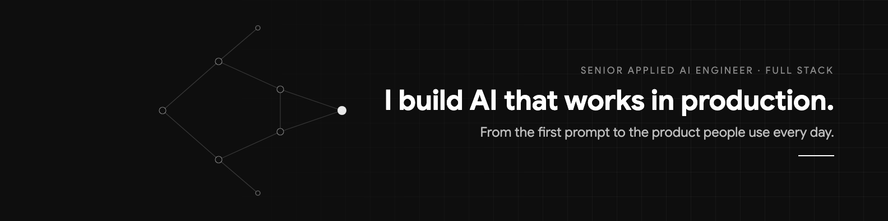

### Hi, I'm Ashwin

I build AI products that hold up in production. Mostly LLM agents, RAG and evals, plus the TypeScript and Python apps around them.

Right now I'm a founding engineer at Susanoox Digital, building AI products for clients in India, Saudi Arabia, the US and the UK. Before that I was at Richpanel, where I built Sidekick AI, an LLM copilot for customer support teams.

### What I spend my time on

- RAG that cites its sources and admits when it doesn't know
- Tool-calling agents for real business workflows
- Evals, so a prompt change gets measured instead of guessed
- Routing cheap decisions away from expensive models

Most of my work lives in private client repos, so this profile looks quieter than my week does. Happy to walk through any of it on a call.

### Stack

Plus LangChain, LangGraph, Pinecone, pgvector, and the Claude and OpenAI APIs.

### Find me

[LinkedIn](https://www.linkedin.com/in/ashwin-senthilkumar/) · imashwin02@gmail.com
